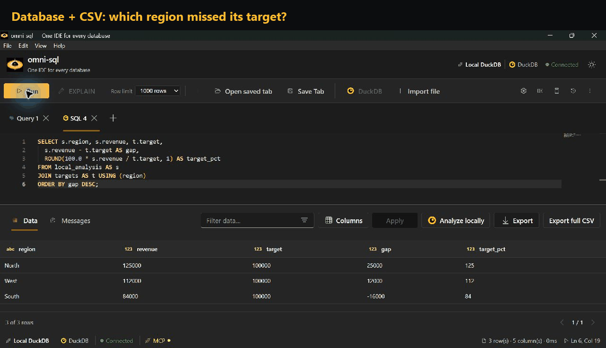
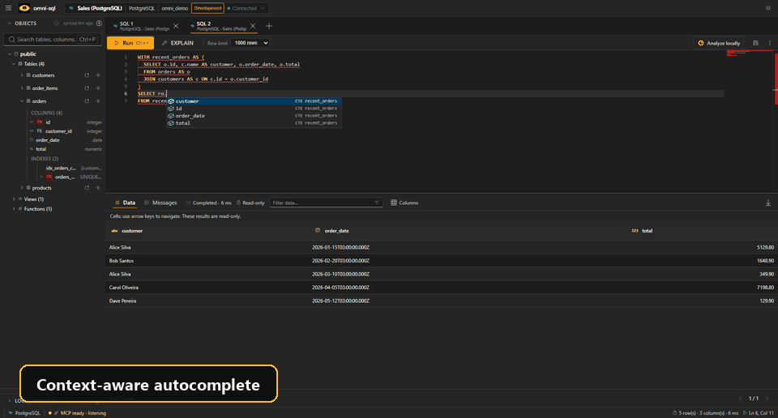
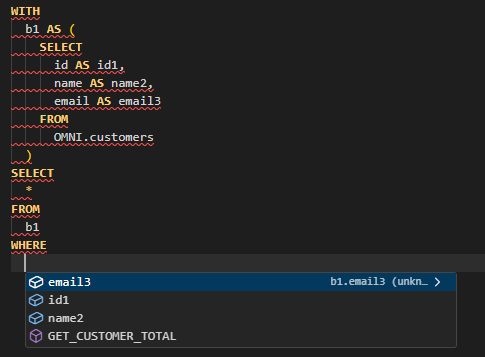
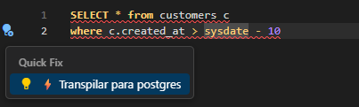
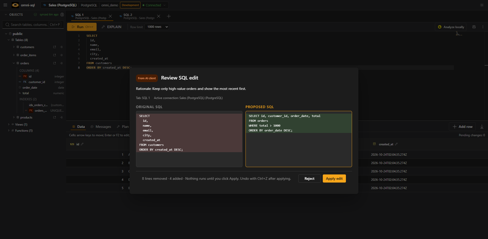

<p align="center"></p>
<h1 align="center">omni-sql</h1>
<p align="center"><strong>Query CSV and Parquet in your SQL IDE, locally.</strong></p>
<p align="center">An open-source SQL workspace with DuckDB analysis and native connections to<br />PostgreSQL, MySQL, MariaDB, SQL Server, Oracle, and MongoDB.</p>
<p align="center"><a href="https://github.com/cccadet/omni-sql/releases/latest"><strong>Download omni-sql</strong></a> · <a href="#quick-start">Quick start</a> · <a href="docs/DATABASE-SUPPORT.md">Database support</a> · <a href="https://cccadet.github.io/omni-sql/docs/">Documentation</a></p>
<p align="center"><strong>Runs locally · No account required · No separate runtime or database client to install</strong></p>
<p align="center">
  <a href="https://github.com/cccadet/omni-sql/actions/workflows/ci.yml"></a>
  <a href="https://sonarcloud.io/summary/new_code?id=cccadet_omni-sql"></a>
  <a href="https://github.com/cccadet/omni-sql/releases/latest"></a>
  <a href="LICENSE"></a>
</p>

<p align="center"><sub>Early-stage software · Windows x64, Linux amd64 and macOS Apple Silicon / Intel</sub></p>

## Features

### Analyze files and database results locally

Received a CSV or Parquet export to investigate? Import it and query it with SQL
in the same IDE, using embedded DuckDB, without loading it into your source
database or writing a separate script. You can also import a query result from
any supported connection and join it with the file locally.



1. Run a source query and choose **Analyze locally**: a full result or a sample.
2. Add a CSV or Parquet file (with a delimiter preview) and join it with SQL.
3. Inspect the result and export the full local query output.

Local datasets persist across restarts, and S3 objects (CSV, Parquet, Delta,
Iceberg, DuckLake) can be queried and imported too. A sample stays a sample:
exports never restore rows left out at import time.
[Try the demo with fictional data](docs/demo/README.md) or read the
[local analysis guide](docs/LOCAL-ANALYSIS.md).

### SQL editing and exploration



- Metadata-aware completion with PK/FK badges and types, including columns
  projected by CTEs; preview a single CTE's rows with **Ctrl+Alt+Enter**.
- Dialect quick fixes, formatting (`Ctrl+Alt+L`) and `/catalog` SQL templates.
- Execution plans for PostgreSQL, MySQL/MariaDB, SQL Server and Oracle.
- Filter, sort, page and export results; edit rows when a primary key makes the
  update safe.
- MongoDB: native Extended JSON queries, a document view, and read-only SQL with
  `/mongo` conversion. See [MongoDB usage](docs/MONGODB.md).

<p> </p>

### Connections

Organize connections in folders, tag them with your own environments
(Development, Staging, Production or custom ones, each with a color), and
import them from an omni-sql export or from DBeaver. Passwords stay in the OS
keyring and are never exported.

### AI assistants through MCP

A local MCP server lets compatible clients (Codex, Claude Desktop, ChatGPT
Desktop) read the active SQL tab, inspect schemas and plans, propose edits, and
run SQL. Edits and executions always need approval in the desktop, and each
connection can be set to Off, Read-only (default) or Read and write.



See the [MCP guide](docs/MCP.md) for setup and the security model.

## Database support

| Database | Connection | Metadata autocomplete | Query execution |
| --- | :---: | :---: | :---: |
|  PostgreSQL | ✅ | ✅ | ✅ |
|  MySQL | ✅ | ✅ | ✅ |
|  MariaDB | ✅ | ✅ | ✅ |
|  SQL Server | ✅ | ✅ | ✅ |
|  Oracle | ✅ | ✅ | ✅ |
| MongoDB | ✅ | ✅ Sampled fields | Native Extended JSON + read-only SQL |
|  Generic JDBC | 🧪 Experimental | Driver-dependent | Driver-dependent |
| ODBC | 🧪 Experimental | Driver-dependent | Driver-dependent |

Generic JDBC needs a user-supplied driver JAR; ODBC needs a separately installed
64-bit driver. Neither offers plans, definitions or row editing. Details and
limitations: [Database support](docs/DATABASE-SUPPORT.md).

## Install

Download your package from the **[latest release](https://github.com/cccadet/omni-sql/releases/latest)**.

| Platform | Package |
| --- | --- |
| Windows 10/11 x64 | `.exe` installer or `x64-portable.zip` |
| Debian/Ubuntu amd64 | `.deb` |
| macOS 15+ Apple Silicon / Intel | `aarch64.dmg` / `x64.dmg` |

On Windows you can also install with [WinGet](https://learn.microsoft.com/windows/package-manager/winget/):

```powershell
winget install cccadet.omni-sql
```

Node.js, Java and the ODBC driver manager are bundled; native connections need
no database client. Release assets include `SHA256SUMS`. Linux ARM, AppImage and
RPM are not packaged yet.

macOS builds are ad-hoc signed and not notarized: on first launch use
**System Settings → Privacy & Security → Open Anyway**. The
[installation guide](docs/INSTALL.md) covers this, the Windows portable archive,
where data is stored, and updates.

> omni-sql is early-stage software. Try it with development data before using it
> against important environments, and please report unexpected behavior.

## Quick start

- **Files only:** choose **Import file**, select a CSV or Parquet file, and query
  it in the **Local DuckDB** tab.
- **A database:** create a connection, choose **Test connection**, connect, then
  browse objects or open a SQL tab. Run the selection or current statement and
  use **Analyze locally** to bring the result into DuckDB.

Stuck? See [Troubleshooting](docs/TROUBLESHOOTING.md).

## When to use omni-sql

omni-sql focuses on SQL editing plus local analysis of database results and
files. Mature tools such as DBeaver and DataGrip cover broader administration;
you can use omni-sql alongside them.

| Choose omni-sql for… | Consider a broader tool for… |
| --- | --- |
| Local DuckDB joins across database results and files | Deep vendor-specific administration |
| One editor across five relational databases and MongoDB | Data modeling and migration tools |
| CTE- and metadata-aware completion | A large plugin ecosystem or enterprise support |
| A local, MIT-licensed app with no account | Team features and a long-established product |

## Documentation

Read the **[documentation site](https://cccadet.github.io/omni-sql/docs/)**:
installation, getting started, the SQL editor, connections, local analysis,
MongoDB, MCP, shortcuts, troubleshooting and contributor guides. The same pages
are in [docs/](docs/README.md).

Built with Tauri, React, Fluent UI, Monaco Editor, TypeScript, Rust, and Kotlin.
The interface is available in English, Portuguese and Simplified Chinese.

## Contributing

If omni-sql is useful to you, **[star the repository](https://github.com/cccadet/omni-sql)**.
[Report a bug](https://github.com/cccadet/omni-sql/issues/new/choose), share a
database compatibility result, or
[tell us about your first run](https://github.com/cccadet/omni-sql/issues/new?template=first_run.yml).
Pull requests are welcome; read [CONTRIBUTING.md](CONTRIBUTING.md) first.

## License

[MIT](LICENSE)
