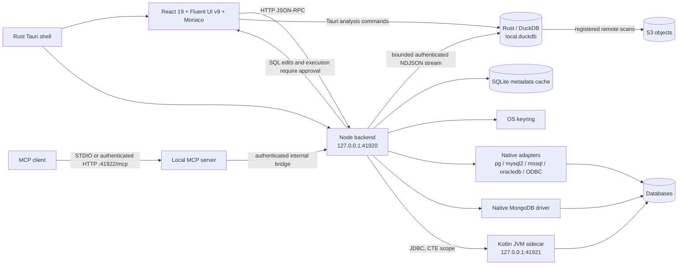

# Architecture

omni-sql is a local desktop application. Several processes cooperate over
loopback; the browser Vite mode exists only for frontend development.

## Components

- **Tauri shell (Rust):** spawns and health-checks the Node backend and the
  optional JVM sidecar with per-run auth tokens, owns the window, and exposes
  restricted file-picker and local-analysis commands.
- **Frontend:** React 19, Fluent UI v9 and Monaco. Talks to the backend through
  the JSON-RPC contract in `packages/backend/src/protocol.ts`.
- **Node backend:** owns connections, adapters (behind the `adapters-core`
  registry and caching wrapper), metadata sync, autocomplete orchestration,
  MongoDB SQL translation and the MCP bridge.
- **Metadata cache:** SQLite via `node:sqlite`. Passwords use the OS keyring;
  a file fallback exists only for development and must be enabled explicitly.
- **Native adapters:** PostgreSQL (`pg`), MySQL/MariaDB (`mysql2/promise`),
  SQL Server (`mssql`/Tedious), Oracle (`oracledb` thin mode) and experimental
  ODBC (`odbc`). MongoDB uses the native `mongodb` driver; see [MONGODB.md](MONGODB.md).
- **JVM sidecar:** Kotlin + Apache Calcite. Resolves CTE output columns for
  tier-2 autocomplete and loads user-supplied JDBC drivers. See its
  [README](../services/jvm-sidecar/README.md).
- **MCP server:** STDIO by default, optional authenticated Streamable HTTP on
  `41922`. It forwards to the backend's separate `/mcp` bridge. See [MCP.md](MCP.md).
- **Analytical engine:** Rust + embedded DuckDB in `apps/desktop/src-tauri/src/data_engine.rs`.

## Autocomplete

Completion is two-tier. Tier 1 is the lexer and contextual engine driven by
`dialect-descriptors` plus cached metadata. For CTEs, the backend asks the
sidecar (`/scope/resolve`, 250 ms timeout) for output column names. A missing,
slow or failing sidecar falls back to tier 1; completion requests never fail
because of it.

## Local analysis engine

Rust owns local datasets, analytical queries, file import/export and S3 scans;
Node stays the owner of relational connections and streams source rows to Rust
as bounded, typed NDJSON. The engine serializes work behind a mutex with one
active operation plus interruption/status APIs.

Design rules:

- Grid preview limits are independent from ingestion: changing a preview limit
  never changes an aggregate over loaded rows.
- Full, first-N and reservoir imports have distinct semantics. A failed full
  import never becomes a partial dataset; datasets are published only after the
  table and registry entry commit together.
- Exact numbers, temporal precision, binary values and nulls are preserved, or
  the import fails with an explicit cast hint.
- Sampled/truncated provenance follows datasets through joins and exports.
- Engine-generated SQL always escapes identifiers; the editor may omit quotes.

Lifetimes: durable datasets and their registry live in `local.duckdb` in the
Tauri app data directory (private permissions on Unix). Federated datasets,
result pages and staging files are temporary.

Security: the local connection uses restricted configuration. S3 uses separate
reader connections that install and load extensions and register sources, then
disable extension autoloading and the local filesystem and lock configuration
before running editor SQL. S3 editor SQL must use registered sources; direct
file-reader functions and URI literals are rejected. S3 credentials never enter
provenance or logs.

Resources: 512 MB DuckDB memory limit, two threads, a 10,000-row / 16 MiB
preview ceiling, a 4 GiB per-dataset budget and a 32 MiB reservoir sample
budget. These are not a process-wide memory or disk guarantee.

Known gaps, tracked as validation work rather than confirmed defects:

- Real-source type-fidelity matrix for MariaDB and a modern ODBC driver.
- Offline extension installation failures and broader S3 credential cases.
- Forced-crash cleanup and cancellation of remote S3 scans.
- Combined Node/Rust memory, peak temporary disk and low-disk behavior.

Typed NDJSON stays until a benchmark shows Arrow IPC is faster end to end
including driver conversion; moving relational adapters to Rust requires
measured benefit and behavioral parity.
