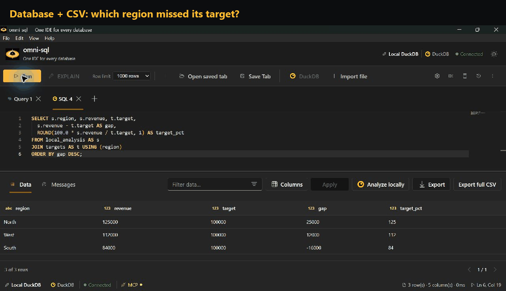

# Local analysis with DuckDB

omni-sql embeds DuckDB for local analysis. Import query results, local files and
S3 objects as datasets, then query and join them with DuckDB SQL in the
**Local DuckDB** tab or in **Analyze locally**.

## Importing data

| Source | How |
| --- | --- |
| Query result | Run a query and choose **Analyze locally**. A new DuckDB tab opens with the imported data; your original tab keeps its SQL and connection. |
| Local file | **Import file** accepts CSV, JSON and Parquet. CSV imports show a preview of up to 20 rows and let you pick comma, semicolon, Tab or a custom single-character delimiter. |
| S3 | Create an S3 connection; buckets appear as schemas in **Objects**. CSV and Parquet work out of the box; Delta, Iceberg and DuckLake depend on DuckDB extensions that may need network access on first use. |

For a query result, choose either the **Full query result**, which streams the
source query to completion within local resource budgets, or a sample (first N
rows or a seeded reservoir). The result grid's row limit is a display preview
and does not limit a full import.

**DuckLake:** configure a catalog on the S3 connection for a bucket or table
prefix. The catalog can be a saved PostgreSQL connection or a SQLite/DuckDB
file; the longest matching prefix wins when a bucket contains mixed data.

## Storage

Datasets are saved in the application's `local.duckdb` and survive restarts.
Renaming a dataset changes its SQL name; dropping it removes its table and
metadata. Datasets used only for a session's joins, temporary result pages and
staging files are cleared when the app exits.

In Analyze locally, **Browse all rows** materializes a stable temporary result
and pages through it 1,000 rows at a time. Editing the SQL or leaving the
workspace releases it.

## Exporting

- **Export** in the result grid writes only the displayed rows.
- **Export full CSV** (DuckDB editor) and the analytical export (CSV or Parquet)
  rerun the local query and write every row. CSV exports accept a delimiter, and
  text starting with a spreadsheet formula prefix is neutralized.
- Full exports write a companion `<result>.omni.json` with the coverage and
  origin of the workspace datasets. Raw SQL is omitted so query literals are not
  copied to disk.
- Direct S3 query results are bounded previews. To export every row, import the
  object as a dataset first.

## Coverage and provenance

A full export contains every row of the local query, but it cannot restore rows
left out by a sample or a truncated import. Analyze locally warns when a
workspace dataset is sampled or truncated.

| Entry point | Recorded coverage | Origin recorded |
| --- | --- | --- |
| Displayed grid | `truncated` if more rows existed, otherwise `complete` | Connection and SQL; the original execution time is unknown |
| Streamed query | `complete` only after the source signals completion; samples are `sampled` | Connection, SQL, and the stream's start/finish times |
| Local file | `complete` for the file as read; samples are `sampled` | File path |
| S3 object | `complete` for the registered scan; samples are `sampled` | S3 URI |

Different datasets may reflect different source snapshots. An aggregate over a
sample describes the sample, not the source.

To compare repeatable samples inside a local query, use DuckDB's
`USING SAMPLE reservoir(1000 ROWS) REPEATABLE (42)` on each input subquery.
Sampling both sides of a join can drop matching rows.

## Type fidelity

The backend streams rows to DuckDB as newline-delimited JSON batches followed by
a completion frame. A missing completion frame, an oversized or malformed frame,
or a source disconnect fails the import without publishing a partial dataset.
Exact decimals and integers beyond JavaScript's safe range travel as strings;
dates and times travel as text when the driver preserves their precision.

When a driver has already lost precision, the import fails and asks for an
explicit cast in the source SQL:

| Source | Problem | Workaround |
| --- | --- | --- |
| SQL Server | Very large `DECIMAL`/`NUMERIC` values | Cast to `VARCHAR` |
| SQL Server, Oracle | Sub-millisecond timestamps | Cast to text (`VARCHAR`, or `TO_CHAR(col, 'YYYY-MM-DD HH24:MI:SS.FF6')` on Oracle) |
| ODBC | Decimal and date/time values of uncertain precision | Cast to text |

MySQL and Oracle return large numeric values as text automatically. Nested
DuckDB values appear as JSON in previews, with decimal members kept as strings.
