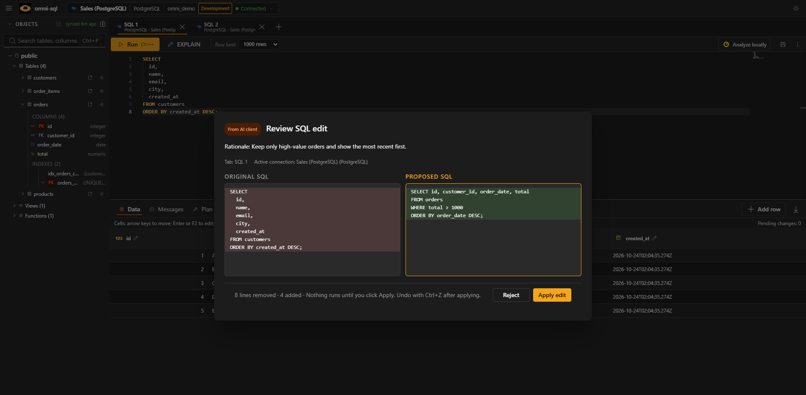

# MCP integration

omni-sql includes a local MCP server that lets compatible AI clients work with
the SQL tab you have open. It uses STDIO by default and talks only to the
authenticated backend on `127.0.0.1:41920`. Streamable HTTP is opt-in and
listens on loopback only.



```text
AI client ──MCP (STDIO or HTTP)──▶ local MCP server ──▶ backend ──▶ active desktop tab
                                                         edits and execution require approval
```

## Tools

| Tool | What it does |
| --- | --- |
| `getActiveSql` | SQL and dialect of the active tab (dialect is `null` without a connection) |
| `getActiveConnectionContext` | Safe connection context, without passwords or credentials |
| `getSchemaSummary` | Schemas, relations and columns; accepts `schema`, `table`, `offset`, `limit` (default 50, max 100) and returns `nextOffset` when more exist |
| `getTableIndexes` | Indexes of one table |
| `explainSql` | Query plan without executing the query |
| `getLatestSqlExecutionError` | Latest execution error in the active tab |
| `proposeSqlEdit` | Before/after proposal that you apply or reject in the desktop; stale proposals are rejected |
| `executeSql` | Runs SQL after desktop approval; accepts `sql` and `limit` (default 100, max 1,000) and returns columns, rows, timing, affected count and `truncated`/`rowsMoreAvailable`, capped at 256 KiB |

There are no tools to read other connections, stored credentials, files, the
shell or processes. SQL, schema names, metadata and permitted results returned
by the tools are visible to the connected client; use the integration only when
that exposure is acceptable.

## Per-connection access

Each connection has an **MCP access** setting (`options.mcpAccess`):

| Level | Effect |
| --- | --- |
| Off | No tool answers for a tab on this connection, not even `getActiveSql` |
| Read-only (default) | Schema, indexes and plans. `executeSql` accepts one `SELECT`, `WITH`, `VALUES`, `TABLE`, `SHOW`, `DESCRIBE` or `EXPLAIN` (without `ANALYZE`); on MongoDB only `find` and `aggregate` without `$out`/`$merge` |
| Read and write | Any SQL, always with desktop approval |

Connections without an explicit choice are read-only; unknown connections are
treated as Off. The desktop refuses disallowed SQL before showing the approval
dialog, and the backend checks again, so an approval never widens a
connection's permission. Changes apply from the next request.

Read-only mode rejects statements that write, lock rows or change the session
anywhere in the text (`INSERT`, a `DELETE` inside a CTE, `SELECT INTO`,
`FOR UPDATE`, `CALL`, `EXEC`, `SET`, …), ignoring strings, comments and quoted
identifiers. Side-effecting functions cannot be detected from text, so on
PostgreSQL, MySQL and MariaDB the statement also runs inside a read-only
transaction that is always rolled back. SQL Server, Oracle, JDBC and ODBC rely on
the text check alone; use a least-privilege database user anyway.

## Approvals

`executeSql` can change data and structure. An approval is bound to the request
and connection, cannot be replayed and expires with the request (120 s).
Rejecting, switching tab or connection before approving, or cancelling the
request starts no SQL. MCP cancellation and timeouts reach the adapter when it
supports cancellation; cancelling does not undo statements already committed.

While omni-sql is in the background, approval requests show a desktop
notification (Settings → General → Desktop notifications). The MCP panel shows
desktop availability, pending requests, HTTP sessions and a history of tool
calls (timing and outcome, never returned rows). A pending approval does not
block read tools.

## Connecting a client (STDIO)

1. Start omni-sql and wait for **MCP** to show as ready in the status bar.
2. Open the **MCP** status item and copy the generated `command` and `args`.
   In development, build the server first with
   `pnpm --filter @omni-sql/mcp-server build`.
3. Paste them into your client exactly as generated. `command` is the Node
   runtime, `args[0]` the MCP server entry point and `args[1]` a temporary
   runtime descriptor. Do not add a working directory or reorder arguments.

The descriptor holds a capability for the current run only: do not open, copy or
share its contents. It is regenerated on every start, so copy a fresh
configuration after restarting omni-sql. Never paste tokens, passwords or
connection strings into a client configuration.

**Codex** (`~/.codex/config.toml`):

```toml
[mcp_servers.omni_sql]
command = "<command>"
args = ["<args[0]>", "<args[1]>"]
```

or `codex mcp add omni-sql -- "<command>" "<args[0]>" "<args[1]>"`.
See [Codex MCP](https://developers.openai.com/codex/extend/mcp).

**Claude Desktop** (**Settings → Developer → Edit Config**):

```json
{
  "mcpServers": {
    "omni-sql": {
      "command": "<command>",
      "args": ["<args[0]>", "<args[1]>"]
    }
  }
}
```

Merge into an existing `mcpServers` object rather than adding a second one, and
double each backslash in Windows paths. Restart Claude Desktop completely; the
server should appear as **Running** under **Connectors** (otherwise check the
developer logs).

**ChatGPT Desktop:** in its apps/connectors settings choose **STDIO** and paste
the command and arguments. ChatGPT in the browser cannot reach a local STDIO
server; it needs a remote HTTPS integration, which is outside this feature.

## Streamable HTTP

In the desktop, open **MCP → Configuration → HTTP**, enter a token of at least
16 characters and a port (default 41922), and choose **Start HTTP**. Configure
the client with the displayed endpoint (`http://127.0.0.1:41922/mcp`) and an
`Authorization: Bearer <token>` header. The token is not persisted or included
in copied configurations. **Stop HTTP** ends the sessions; closing omni-sql
stops the listener. `http://127.0.0.1:41920/mcp` is the internal bridge and does
not speak MCP.

By default the listener accepts local hosts only and rejects requests with an
external `Origin`. To put it behind a tunnel, add the tunnel's HTTPS origin to
the allowed origins.

A standalone launcher is also available:

```bash
OMNI_SQL_MCP_HTTP_TOKEN='<separate secret>' \
  node dist/index.js '<descriptor>' --transport streamable-http
```

`OMNI_SQL_MCP_HTTP_TOKEN` authenticates HTTP clients; never reuse the
descriptor's token. Non-loopback hosts are rejected, and sessions are few and
expire when idle.

A secure tunnel must be the only public boundary: it terminates HTTPS and public
authentication, injects `Authorization: Bearer <OMNI_SQL_MCP_HTTP_TOKEN>`
upstream without exposing it, and forwards to `http://127.0.0.1:41922/mcp`
preserving `POST`/`GET`/`DELETE`, the `Mcp-Session-Id`, `Mcp-Protocol-Version`,
`Last-Event-ID`, `Accept` and `Content-Type` headers, and SSE/chunked streaming
without buffering.

## Standalone mode

`node dist/index.js --standalone` (or `OMNI_SQL_MCP_STANDALONE=1`) starts the
server without a runtime descriptor. It exists so registries and catalogs such
as Glama can build the server and run MCP introspection (`initialize`,
`tools/list`) without the desktop app. It is not a way to use omni-sql:

- It lists the same eight tools with the same input/output schemas and
  annotations as the desktop-launched server.
- Every tool call returns an `unavailable` error ("omni-sql desktop is not
  running") without making any request; there is no endpoint, token,
  credential or database access in this mode.
- It runs only over STDIO. Passing a descriptor (argument or
  `OMNI_SQL_MCP_DESCRIPTOR`) or selecting Streamable HTTP is rejected, so it
  cannot be combined with the normal mode by accident.

Without `--standalone`, the descriptor is still required and the desktop path
is unchanged.

[`packages/mcp-server/Dockerfile`](../packages/mcp-server/Dockerfile) builds
this mode with pnpm 11.17.0 and Node 22 and ships only the bundled server. Build
it from the repository root:

```bash
docker build -f packages/mcp-server/Dockerfile -t omni-sql-mcp .
```

```bash
docker run -i --rm omni-sql-mcp
```

## Verifying the setup

1. Open a connected SQL tab and confirm **MCP** is ready in the status bar.
2. From the client, list the eight tools and call `getActiveSql`.
3. Call `proposeSqlEdit` with, for example,
   `{"sql": "SELECT id, name FROM customers ORDER BY name;", "rationale": "Make the columns and order explicit."}`.
   The desktop shows a diff without changing the tab.
4. Apply or reject it and check the result returned to the client. If the tab
   changes while the dialog is open, the proposal is rejected as stale.
