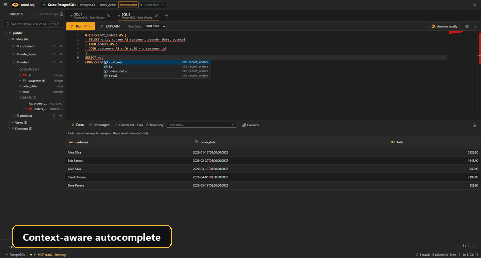
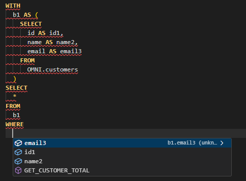
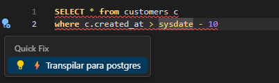

# SQL editor

The editor is built on Monaco and knows the active connection's dialect and
metadata. Each tab is bound to one connection, shown in the tab title.

## Running SQL

| Action | Shortcut |
| --- | --- |
| Run the selection or the statement under the cursor | **Ctrl+Enter** |
| Run every statement in the tab, in order | **Ctrl+Shift+Enter** |
| Preview the CTE under the cursor | **Ctrl+Alt+Enter** |
| Format the SQL | **Ctrl+Alt+L** (configurable) |
| Save the tab to a `.sql` file | **Ctrl+S** |

On macOS, use **Cmd** instead of **Ctrl**. Long-running queries can be
cancelled where the driver supports it, and while omni-sql is in the background
a query that takes 10 seconds or more shows a desktop notification when it ends.

**Variables:** write `:name` in a statement and omni-sql asks for its value
before running. Values are inserted as text literals (`:name` becomes
`'value'`). PostgreSQL casts like `::int` and text inside strings or comments
are not treated as variables.

**Safety checks:** before running `DROP`, `TRUNCATE`, `ALTER TABLE … DROP`, or
`DELETE`/`UPDATE` without `WHERE` (and native MongoDB updates or deletes),
omni-sql shows the statements and asks you to confirm. Dropping an object
requires typing its name. For warning-level statements you can stop the warning
for one connection.

**History:** every execution is kept in the history panel, where you can search
it and reopen past SQL.

## Completion

Completion combines the connection's cached metadata with the SQL you are
writing:

- Schemas, tables, views, columns and functions in context, with PK/FK badges,
  data types, `NOT NULL`, foreign-key targets and column descriptions.
- Columns projected by CTEs and subqueries, tagged with the CTE name.
- Keywords and functions of the active dialect.

CTE columns are resolved by the bundled JVM sidecar. If it is unavailable,
completion still works with metadata alone.

Refresh a connection's metadata from the sidebar after schema changes.

## CTE preview

A **Preview** lens appears above each common table expression. It runs that CTE
together with the CTEs before it and shows its rows in the results grid, without
changing the editor text or the history. The usual row limit, cancellation,
variables and safety checks apply. Previews are refused for data-modifying CTEs
(`INSERT`, `UPDATE`, `DELETE`, `MERGE`) and on MongoDB.

## Templates and quick fixes

Type `/catalog` to browse SQL templates for the active dialect, grouped by data,
schema, indexes, security, transactions and diagnostics. `/catalog insert`, for
example, inserts an **Insert row** example.

When a statement uses syntax from another dialect, a diagnostic can offer a quick
fix that rewrites it for the active database.

## Formatting

Formatting uses `sql-formatter` with the language of the active dialect. Change
the shortcut, keyword case, indentation and other options in
**Settings → SQL formatting**.

## Results

- Filter, sort and page results; choose visible columns; hover a header to see
  the column's type and description.
- **Export CSV** writes the displayed rows with the delimiter you choose. To
  export every row of a large result, use [local analysis](LOCAL-ANALYSIS.md).
- Navigate cells with the arrow keys, **Home**/**End** and **Ctrl+Home**/**Ctrl+End**.

### Editing rows

When a result comes from a single table with a primary key, cells become
editable: press **Enter** or **F2** to edit and **Escape** to cancel, or use
**Add row** to insert one. Edits are held as pending changes until you choose
**Apply** (or **Discard**), and each update must affect exactly one row or it is
rolled back. Generic JDBC and ODBC results are read-only.

## Execution plans

**Explain SQL** shows the plan without running the query, where supported:

| Database | Plan source |
| --- | --- |
| PostgreSQL | `EXPLAIN (FORMAT JSON)` |
| MySQL / MariaDB | `EXPLAIN FORMAT=JSON` |
| SQL Server | `SET SHOWPLAN_XML ON` in an isolated transaction |
| Oracle | `EXPLAIN PLAN`, with row, byte, cost and time estimates and predicates |
| MongoDB | Native explain, plus the DuckDB plan when both engines are used |

## Appearance

**Settings** offers light and dark themes, a compact density for the grid and
sidebar, and the interface language (English, Portuguese or Simplified Chinese).
